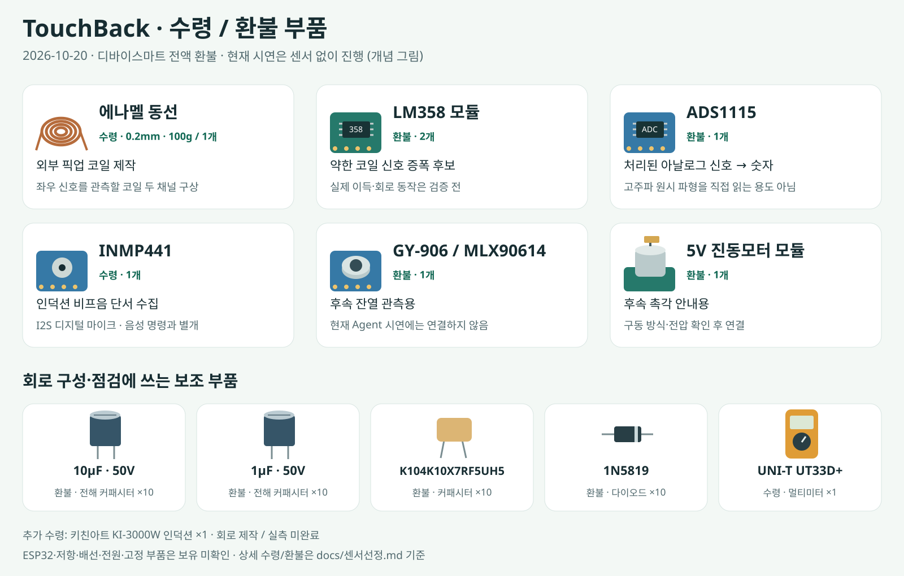
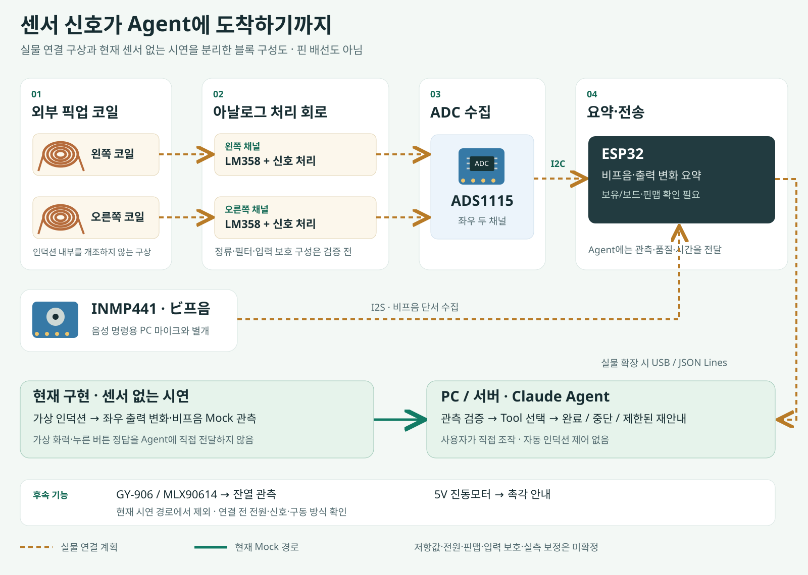

# TouchBack

**인덕션을 조작한 뒤, 원하는 변화가 일어났는지 관측 근거로 확인하는 접근성 AI Agent.**

사용자가 직접 조작하면 Agent가 목표와 관측을 비교하고, 결과 확인·중단·제한된 재안내·교정 제안을 선택한다. 현재 시연은 **가상 인덕션 + 모의 센서 관측 + 실제 Claude API**로 진행한다. 실물 인덕션을 자동 제어하지 않는다.

## 지금 구현된 것

2026-10-20, PR #35까지 main 병합 기준이다.

- 좌우 가상 화력을 실행 사이에 유지하고, 한 화구의 한 단계 증가·감소를 지원한다.
- 양쪽 관측을 비교해 다른 화구 변화·반대 방향·변화 없음·품질 이상을 구분한다.
- 실제 모델이 관측 조회 → 필요한 안전성 검토 → 다음 행동을 Tool로 선택한다. 품질·시간창·보정·재시도 한도는 서버가 별도로 검증한다.
- 교정은 사용자가 목표를 확인한 뒤 새 실행으로 시작한다. 자동 교정·자동 가열은 없다.
- 지원 브라우저의 PC 마이크로 목표 문장을 입력하고, 확인·수정 후 직접 실행할 수 있다.
- 테스트는 백엔드 **609개**, 프런트 **99개** 통과. 실제 Claude+Mock 정상·다른 화구·미인식 복구·센서 오류의 개발 호출 기록은 [Agent 판단](docs/Agent판단.md)에 정리했다.

실제 회로 제작·센서 연결·실측 보정·실물 정확도·실제 마이크 인식·대상 사용자 평가는 별도 검증이 남아 있다. 구현과 테스트 통과를 이 검증들의 완료로 해석하지 않는다.

## 어떤 부품을 샀고, 어디에 쓰나?

아래는 확정 견적의 **11개 품목**을 역할별로 그린 것이다. 실물 사진이 아닌 개념 일러스트이며, 상품명·수량의 기준은 [구매 확정 목록](docs/센서선정.md)이다. 부품 구매 구성과 실제 배선·측정 완료 여부는 구분한다.



| 부품 | 확정 수량 | 프로젝트에서 맡을 역할 |
|---|---:|---|
| 에나멜 동선 0.2mm · 100g | 1개 | 외부 픽업 코일 제작 재료. 좌우 신호 두 채널을 관측하는 구상 |
| LM358 증폭 모듈 | 2개 | 코일의 약한 신호를 처리하는 증폭 회로 후보 |
| ADS1115 ADC 모듈 | 1개 | 처리된 아날로그 신호를 숫자로 수집. 고주파 원시 파형 분석용으로 가정하지 않음 |
| INMP441 I2S 마이크 | 1개 | 인덕션 비프음을 입력 인식의 단서로 수집 |
| GY-906 / MLX90614ESF 온도센서 | 1개 | 후속 잔열 관측. 현재 시연 경로에는 연결하지 않음 |
| 5V 진동모터 모듈 | 1개 | 후속 촉각 안내. 현재 시연 경로에는 연결하지 않음 |
| 전해 커패시터 50V 10μF / 50V 1μF | 각 10개 | 신호 처리 회로 구성용 |
| K104K10X7RF5UH5 커패시터 / 1N5819 다이오드 | 각 10개 | 필터·정류 회로 구성 후보. 실제 동작은 측정으로 확인 필요 |
| UNI-T UT33D+ 멀티미터 | 1개 | 회로의 전압·저항·연결 점검. 파형 측정을 대신하지 않음 |

**ESP32는 위 견적 11개 품목에 포함되지 않는다.** 보드·저항·배선·전원·고정 부품의 보유/추가 확보와 실제 핀맵은 별도 확인 사항이다. 센서를 사용하지 않는 현재 시연에는 이 보드 연결을 요구하지 않는다.

## 회로와 신호 흐름을 그림으로 보면

실물 확장의 구상은 **좌우 코일 → 아날로그 처리 → ADS1115 → ESP32 → 서버 Agent**다. 비프음용 INMP441은 ADC를 거치지 않고 I2S로 수집하는 별도 경로다.



- **주황 점선: 실물 연결 계획.** 인덕션 내부 회로를 개조하지 않는 외부 관측 구상이다. 증폭·정류·필터·입력 보호·전원·저항값·핀맵은 검증 전이며, 그림을 그대로 배선하는 제작 회로도가 아니다.
- **초록 실선: 현재 구현한 시연 경로.** 모의 관측을 기존 검증·Agent 경로로 처리한다. 가상 화력이나 실제 누른 버튼 정답을 Agent에 직접 전달하지 않는다.
- **비프음과 음성 명령은 다른 입력이다.** INMP441은 인덕션의 비프음 수집 계획이고, 현재 음성 목표 입력은 PC 마이크와 브라우저 음성 인식을 사용한다. INMP441 음성 전송 펌웨어를 구현한 것은 아니다.
- 코일 신호를 곧바로 정확한 화력 단계로 읽는다고 가정하지 않는다. 실제 좌우 분리·단계 구분에는 설치·신호 처리·보정·실측 근거가 필요하다.

자세한 개발 가정과 한계는 [모의 관측 범위](docs/모의관측범위.md), 실제 부품 검토는 [센서 선정](docs/센서선정.md)을 따른다.

## Agent는 어떻게 움직이나?

```text
사용자 목표 → 목표 검증·계획 → 조작 안내 → 사용자의 가상 버튼 조작
    → 좌우 모의 관측·품질 검증 → 모델의 Tool 호출·다음 행동 선택
    → 결과 확인 / 중단 / 제한된 재안내 / 사용자 확인 교정 제안
```

관측 단계의 모델은 `inspect_observation`으로 근거를 조회하고, 필요하면 `assess_retry_safety`로 지연 관측·재시도 조건을 검토한 뒤 `choose_next_action`을 호출한다. 모델이 선택해도 서버 안전 조건을 통과하지 못하면 성공·재안내를 허용하지 않는다. 구현은 [Agent 판단](docs/Agent판단.md), [실행 계약](docs/실행계약.md), [Skill 디렉터리](skills/)에서 확인할 수 있다.

| 실행 방식 | 모델 | 관측 | 용도 |
|---|---|---|---|
| `real_llm` | 실제 Claude API (OpenAI 대안도 제공) | 현재 시연은 Mock | 모델의 Tool·행동 선택 확인 |
| `mock_llm` | 고정된 모의 응답 | Mock | 비용 없는 흐름 연습·회귀 검사 |
| `backend_stub` | 준비용 기본 모드 | 센서 미설정이면 확인 불가 종료 | 설정 전 서버·실행 계약 확인 |
| `?fixture=1` | 외부 모델 호출 없음 | 브라우저 화면 예시 | UI 연습. 실제 Agent 성공 증거 아님 |

## 로컬에서 실행하기

Python 3.12를 사용한다. PowerShell에서 저장소 루트 기준으로 실행한다.

```powershell
cd C:\TouchBack
python -m venv .venv
.\.venv\Scripts\python.exe -m pip install -r backend/requirements-dev.txt
if (-not (Test-Path .env)) { Copy-Item .env.example .env }
.\.venv\Scripts\python.exe -m uvicorn app.main:app --app-dir backend --host 127.0.0.1 --port 8000
```

1. `http://127.0.0.1:8000/`를 연다. 기본 화면이 실제 백엔드 API를 사용한다.
2. **시연 설정 → Mock LLM → 시연 설정 적용**으로 비용 없이 연습한다. 정상 반응은 기본값이다.
3. **오른쪽 한 단계 올리기 → 안내 시작 → 오른쪽 가상 + 버튼**을 누른다. 모의 관측과 최종 판정을 확인한다.
4. 정상·다른 화구·반대 방향은 직접 가상 버튼을 선택한다. 미인식·센서 오류 등은 상단 **장치 반응**에서 시험한다.
5. 실행 종료 후 다음 목표를 시작할 수 있다. 가상 화력을 5/5로 초기화하려면 **시연 설정**에서 명시적으로 초기화한다.

음성 입력은 **음성 입력 → 마이크 허용 → 문장 인식 → 확인·수정 → 안내 시작** 순서다. 지원하지 않거나 권한/서비스 오류가 발생하면 텍스트 입력을 사용한다. 실제 마이크 인식은 아직 별도 검증 사항이다.

### 실제 Claude로 시연하기

서버 루트의 로컬 `.env`에 아래 설정을 넣고 서버를 다시 시작한다. 키는 채팅·브라우저 코드·저장소에 넣지 않는다.

```dotenv
TOUCHBACK_LLM_PROVIDER=anthropic
ANTHROPIC_API_KEY=발급받은_키를_로컬에만_입력
CLAUDE_MODEL=claude-haiku-5-5
```

화면의 **시연 설정 → 실제 AI → 시연 설정 적용**을 선택한다. 키 설정 표시는 실제 호출 성공 자체를 뜻하지 않으며, 실행 기록의 Tool 선택과 사용량으로 확인한다. UI 설정은 서버 메모리에 적용되며 `.env` 파일을 수정하지 않는다. 센서 입력은 계속 Mock이다.

`/health`는 서버 구동 확인용이며 현재 `agent_ready: false`는 고정된 준비 표식이다. 실제 API 연결 여부는 시연 설정과 실행 기록을 기준으로 확인한다. 자세한 설정은 [Agent 실행](docs/Agent실행.md)과 [.env.example](.env.example)을 참고한다.

## 검사와 검증 범위

아래는 실제 API 과금을 방지하도록 키를 비운 **별도 테스트 터미널**에서 실행한다. 로컬 `.env` 파일은 변경하지 않는다. 프런트 검사는 Node.js 20 이상이 필요하다.

```powershell
$env:TOUCHBACK_EXECUTION_MODE='backend_stub'
$env:TOUCHBACK_DEMO_ENABLED='false'
$env:OPENAI_API_KEY=''
$env:ANTHROPIC_API_KEY=''
.\.venv\Scripts\python.exe -m pytest -q backend
node --test tests/integration/frontend.test.mjs
```

- 코드·모의 HTTP/센서/DOM 회귀: 백엔드 609개, 프런트 99개 통과.
- 실제 Claude+Mock 개발 호출: 정상·다른 화구 중단·미인식 후 재안내·센서 오류 중단 확인. 통계적 모델 정확도 검증과 구분한다.
- 실물 회로/센서/인덕션, 실제 음성 인식, 스피커·화면 낭독기·대상 사용자 평가는 별도다.
- IR 잔열·진동·레시피/개인화를 현재 구현 완료에 포함하지 않는다. 제안서의 정확도·지연 수치는 실측 달성값이 아니다.

## 문서와 제출 준비

[문서 목록](docs/README.md) · [현재 관측 범위](docs/모의관측범위.md) · [시연 사용법](docs/센서없는시연.md) · [평가·제출 기준](docs/평가와데모.md) · [역할분담](docs/역할분담.md) · [협업 규칙](CONTRIBUTING.md)

제출 자료에는 실제 모델/모의 관측 구분, Agent의 Tool 선택·복구 기록, 구현 범위와 미검증 사항을 함께 담는다. 소스에는 실행 README·설정 예시·구현한 Skill을 포함하고 `.env`·가상환경·로컬 로그는 제외한다. 다른 팀원 환경의 설치·실행 확인과 발표/영상/최종 묶음 점검은 제출 전 준비 작업이다.

원본 PDF 두 개는 사용자 승인으로 [pdf/](pdf/)에 보존하며 수정하지 않는다. 다른 문서의 날짜별 진행 기록은 작성 당시 상태일 수 있으므로 최신 코드·병합 기록과 구분해서 읽는다.
